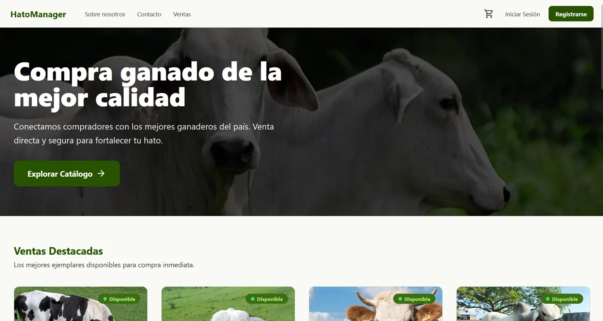

<div align="center">


<a href="https://daniel-ramirez-navarro.netlify.app/">
  <picture>
    <source media="(prefers-color-scheme: dark)" srcset="https://readme-typing-svg.demolab.com?font=Schibsted+Grotesk&weight=700&size=26&duration=3200&pause=1400&color=8EA2FF&center=true&vCenter=true&width=640&height=48&lines=Convierto+hojas+de+c%C3%A1lculo+en+aplicaciones.;Laravel+%C2%B7+React+%C2%B7+Node.js;Del+modelo+de+datos+a+la+interfaz.;Subastas%2C+mapas+y+turnos+en+tiempo+real." />
    
  </picture>
</a>

[](https://daniel-ramirez-navarro.netlify.app/)
[](https://www.linkedin.com/in/daniel-ram%C3%ADrez-navarro-658397376/)
[](mailto:daniel20ramirez06@gmail.com)


</div>

## Convierto hojas de cálculo en aplicaciones.

Es lo que hago hoy en **World Travel Assist**: reúno requerimientos con cada área y reemplazo procesos manuales por interfaces que ahorran tiempo. Trabajo con **Laravel**, **React** y **Node.js**.

```text
 ANTES · FINAL_v3_ahora_si.xlsx               DESPUÉS · HatoManager
┌─────┬──────────┬────────┬──────────┐       ┌───────────────────────────────────┐
│ ID  │ NOMBRE   │ PESO   │ OBS      │       │ Inventario del hato  48 animales  │
├─────┼──────────┼────────┼──────────┤       ├───────────────────────────────────┤
│ 14  │ Lucero   │ 420kg  │          │       │ Lucero    014  420 kg  Activo     │
│ 015 │ la mona  │ 415 KG │ OJO!!    │  ──>  │ La Mona   015  415 kg  En subasta │
│ 16  │ Canela   │ 388    │ ???      │       │ Canela    016  388 kg  Activo     │
│ 017 │ Tormenta │ #¡REF! │ vendida? │       │ Tormenta  017  398 kg  Vendida    │
└─────┴──────────┴────────┴──────────┘       └───────────────────────────────────┘
```

| Ubicación | Disponibilidad | Modalidad | Idiomas |
| --- | --- | --- | --- |
| Colombia | Empleo de tiempo completo o freelance | Presencial o remoto | Español e inglés (C1) |

## Proyectos

Aplicaciones construidas de punta a punta, del modelo de datos a la interfaz.

### [HatoManager](https://github.com/Daniel-RN24/HatoManager) · Gestión ganadera integral

<a href="https://github.com/Daniel-RN24/HatoManager"></a>

- Inventario del hato con historial sanitario y seguimiento de peso
- Subastas en línea con pujas en tiempo real
- Pagos integrados con Wompi


### Otros proyectos

<table>
  <tr>
    <td width="50%" valign="top">
      <h4><a href="https://github.com/Daniel-RN24/MercadoBarrio_Frontend">MercadoBarrio</a></h4>
      <p>Comercio hiperlocal con mapa en vivo: catálogo, inventario y ventas para los comerciantes, y un mapa interactivo en tiempo real para descubrir tiendas cercanas.</p>
      
      
      
      
    </td>
    <td width="50%" valign="top">
      <h4><a href="https://github.com/plapers2/turnosPRO">TurnosPRO</a></h4>
      <p>Turnos y citas con disponibilidad en vivo: asignación de horarios y control de disponibilidad en tiempo real, con un panel de gestión para el personal.</p>
      
      
      
      
    </td>
  </tr>
  <tr>
    <td width="50%" valign="top">
      <h4><a href="https://github.com/Daniel-RN24/biblioteca_mysqli">BibliotecaSena</a></h4>
      <p>Catálogo, reservas y préstamos: administración del catálogo de libros, y reservas y préstamos para estudiantes y personal.</p>
      
      
      
      
      
    </td>
    <td width="50%" valign="top">
      <h4><a href="https://github.com/0mega17/proyectoVideojuego">EduBingo</a></h4>
      <p>Bingo literario para el aula: un juego basado en obras literarias, pensado para fomentar la lectura en clase.</p>
      
      
      
      
      
    </td>
  </tr>
</table>

## Trayectoria

Vengo del diseño multimedia y terminé enamorado del backend. Hoy construyo aplicaciones completas con Laravel o Express y React, desde las migraciones hasta la última interacción en pantalla.

Me gusta resolver problemas reales de punta a punta: automatizo procesos que antes vivían en hojas de cálculo y he construido desde subastas en tiempo real hasta mapas interactivos.

### Experiencia

**Desarrollador Junior Full Stack** · World Travel Assist · 2026–hoy 

Etapa productiva del SENA: reúno requerimientos con los distintos departamentos para automatizar procesos que hoy se gestionan en hojas de cálculo, con interfaces que reducen el tiempo de sus tareas cotidianas.

### Educación

| Período | Título | Institución |
| --- | --- | --- |
| 2025–2027  | Tecnólogo en Análisis y Desarrollo de Software | SENA |
| 2025 | Inglés nivel C1 (MCER) | Macarthur English Academy |
| 2025 | Técnico en Sistemas y Comercio Digital | C.E.I. El Mariscal |
| 2023 | Tecnólogo en Diseño e Integración Multimedia | SENA |

## Tecnologías

Lo que uso a diario y dónde lo he aplicado.

<p align="center">
  
</p>

| Tecnología | Cómo la uso | Proyectos |
| --- | --- | --- |
| **Laravel** | Mi herramienta principal en el backend. Desarrollo con la arquitectura MVC clásica: modelos, controladores y vistas. | HatoManager, TurnosPRO |
| **React** | Interfaces sobre Laravel con Inertia.js o como frontend independiente con Vite. | HatoManager, MercadoBarrio |
| **Node.js** | APIs con Express y Prisma cuando el proyecto lo pide. | MercadoBarrio |
| **WebSockets** | Funciones en tiempo real: pujas en vivo y disponibilidad de turnos al instante. | HatoManager, TurnosPRO |
| **MySQL** | Bases de datos relacionales, con PDO y mysqli desde PHP. | BibliotecaSena, EduBingo |

### También trabajo con

**Frontend**


**Backend y datos**


**Integraciones**


**Herramientas**


## Actividad en GitHub

<div align="center">

<picture>
  <source media="(prefers-color-scheme: dark)" srcset="https://github-readme-stats.vercel.app/api?username=Daniel-RN24&show_icons=true&locale=es&hide_border=true&border_radius=12&bg_color=121a26&title_color=8ea2ff&icon_color=8ea2ff&text_color=eef1f4&ring_color=8ea2ff" />
  
</picture>
<picture>
  <source media="(prefers-color-scheme: dark)" srcset="https://github-readme-stats.vercel.app/api/top-langs/?username=Daniel-RN24&layout=compact&langs_count=6&locale=es&hide_border=true&border_radius=12&bg_color=121a26&title_color=8ea2ff&text_color=eef1f4" />
  
</picture>

<picture>
  <source media="(prefers-color-scheme: dark)" srcset="https://streak-stats.demolab.com?user=Daniel-RN24&locale=es&hide_border=true&border_radius=12&background=121a26&ring=8ea2ff&fire=8ea2ff&currStreakNum=eef1f4&sideNums=eef1f4&currStreakLabel=8ea2ff&sideLabels=eef1f4&dates=a7b0bf&stroke=2b3546" />
  
</picture>

<picture>
  <source media="(prefers-color-scheme: dark)" srcset="https://raw.githubusercontent.com/Daniel-RN24/Daniel-RN24/output/github-snake-dark.svg" />
  
</picture>

</div>

## Contacto

**¿Tienes una vacante o un proceso que automatizar?** Escríbeme y cuéntame de qué se trata; te respondo a la brevedad.

<div align="center">

[](mailto:daniel20ramirez06@gmail.com)
[](https://www.linkedin.com/in/daniel-ram%C3%ADrez-navarro-658397376/)
[](https://daniel-ramirez-navarro.netlify.app/)


</div>
